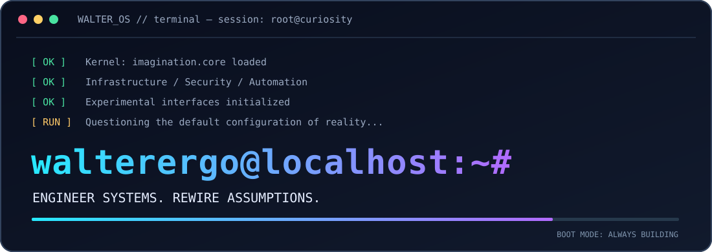

<!-- WALTER_OS :: GitHub profile / public-safe build -->
<div align="center">
  
  <br/><br/>
  
  <br/><br/>
  
  
  
</div>

## `root@walter_os:~# ./whoami --verbose`

```yaml
identity: walterergo
roles: [systems_engineer, technical_leader, platform_builder, idea_explorer]
mission: "Make complex technology useful. Make impossible ideas testable."
operating_system: curiosity-driven
current_state: building
known_bug: "Cannot stop asking: what if?"
```

> **I build infrastructure that survives reality. Then I question reality.**  
> Not everything worth building has a blueprint.

## `root@walter_os:~# systemctl list-units --type=innovation`

| MODULE | STATUS | WHAT'S RUNNING |
|:--|:--:|:--|
| `infra.engine` | `ACTIVE` | Linux · Virtualization · Networking · High availability · Monitoring |
| `security.layer` | `ACTIVE` | Segmentation · Identity · Access control · Resilience |
| `platform.factory` | `BUILDING` | Docker · APIs · Angular · PostgreSQL · Automation |
| `community.universe` | `EXPLORING` | Modular ecosystems · Cross-industry collaboration · Connected experiences |
| `awareness.lab` | `EXPERIMENTAL` | Critical thinking · Context · Human awareness |

## `root@walter_os:~# ls /opt/experiments`

**`01 / AWARENESS LAB · THINK BEYOND THE SIGNAL`**  
Exploring how context, curiosity and critical thinking shape the way we understand information and make decisions. Less noise. More perspective. Better questions.

**`02 / METADRONE · CONNECTED ECOSYSTEMS`**  
Exploring modular community platforms that connect people, organizations, projects and ideas across industries.

**`03 / ENGINEERING LAB · REAL-WORLD SYSTEMS`**  
From enterprise infrastructure to containers and automated workflows: making technology more resilient, observable and maintainable.

<sub>Public-facing experiments only. Private projects, architectures, code, client details and unreleased IP stay private.</sub>

## `root@walter_os:~# cat /proc/stack`

**CORE SYSTEMS**


**BUILD & AUTOMATE**


## `root@walter_os:~# tail -f /var/log/future.log`

```text
[00:00:01] [BOOT]   Loading curiosity kernel ................ OK
[00:00:02] [INFRA]  Building resilient foundations ......... OK
[00:00:03] [SEC]    Trust boundaries under review .......... OK
[00:00:04] [DEV]    Converting ideas into working systems .. RUNNING
[00:00:05] [MIND]   Reconsidering the obvious .............. ALWAYS
[??:??:??] [NEXT]   The best feature hasn't been invented yet.
```

<div align="center">

### `> sudo ./make-future --no-assumptions`

**BUILD THE SYSTEM. BREAK THE PATTERN. KEEP THE QUESTIONS.**

[](mailto:walterergo@live.it)

<sub>WALTER_OS // No hype-driven development. No production changes on Fridays. Probably.</sub>

</div>
